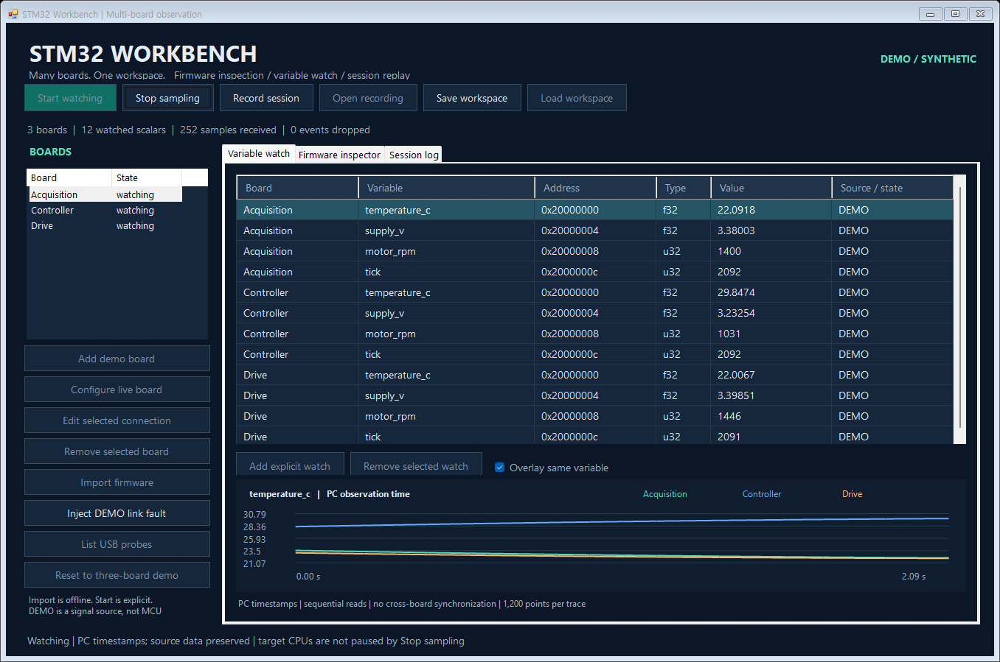
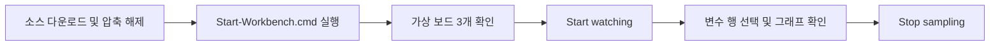
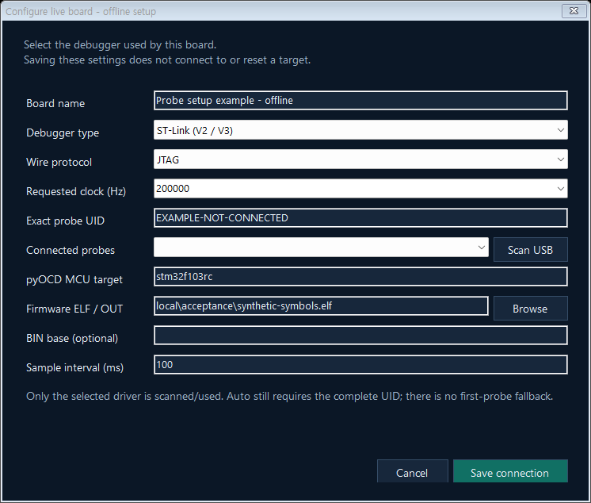
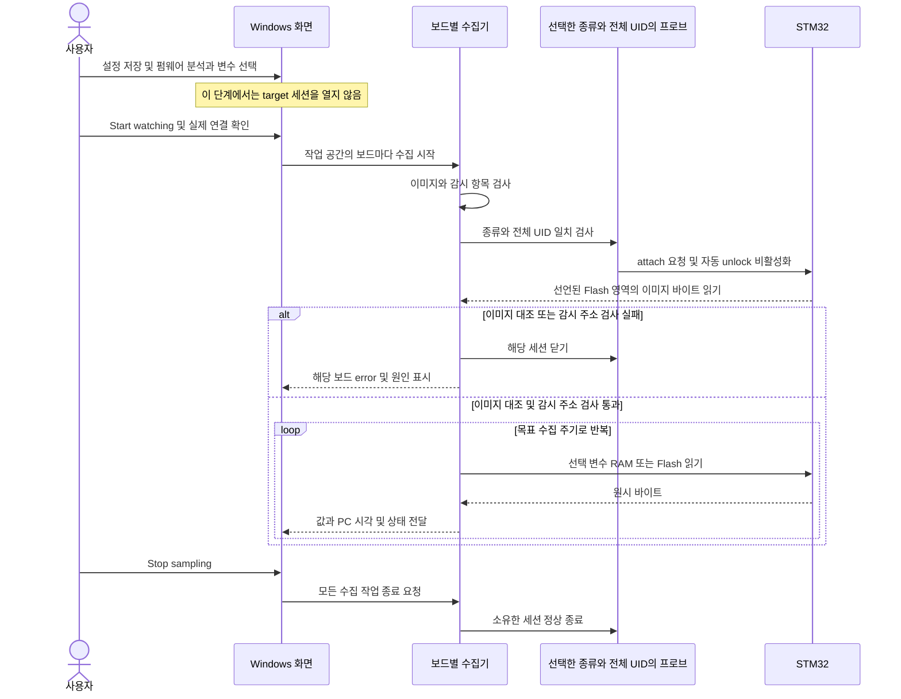
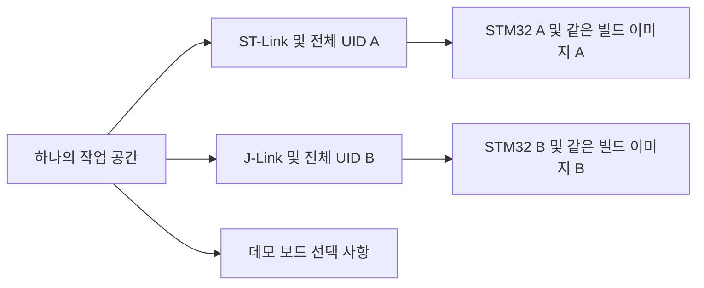

# STM32 Workbench

**여러 STM32 보드를 하나의 작업 공간에서 관측하는 범용 도구입니다.**

펌웨어 파일에서 변수를 찾고, 여러 보드의 값을 한 화면에서 보며, 관측 자료를
저장하고 나중에 보드 없이 다시 재생하는 데스크톱 프로그램입니다. 회사 제품명이나
특정 펌웨어 변수에 의존하지 않는 새 구현입니다.

현재 버전은 **0.1.0 알파**입니다. 새 소스 폴더와 빈 가상 환경에서 실제 Windows
화면 실행·버튼 동작·그래프·기록·재생·재시작 복원을 검증했습니다. 실제 보드 호환성은
아직 미검증입니다. [검증 과정](docs/validation.md)을 함께 확인하세요.



실제 프로그램에서 캡처한 화면입니다. 표시된 데이터는 가상 신호이며 실제 보드 결과가 아닙니다.

## 사용 순서 찾기

| 목적 | 따라 할 순서 |
| --- | --- |
| 보드 없이 먼저 확인 | [바로 실행](#바로-실행) → [데모 시퀀스](#데모-시퀀스) |
| 내 펌웨어 파일 분석 | [지원 파일](#펌웨어-파일만-넣으면-어디까지-되나요) → [보드 없는 펌웨어 분석](#보드-없는-펌웨어-분석) |
| 실제 STM32 변수 관측 | [준비와 설치](#실제-보드-연결) → [연결 설정](#2-연결-설정창-입력) → [변수 선택과 시작](#3-변수-선택과-실제-연결) |
| 여러 보드 함께 관측 | [다중 보드 시퀀스](#다중-보드-시퀀스) |
| 관측 자료 보관·공유 | [기록·재생·작업-공간](#기록재생작업-공간) |
| 연결이 안 되거나 값이 이상함 | [문제 해결](#문제-해결) |

**중요한 구분:** 펌웨어 **불러오기**는 PC에서 파일을 분석하는 과정이고,
**Scan USB**는 프로브 목록을 검색하는 과정입니다. 실제 보드 세션은 작업 공간의
실제 보드가 포함된 상태에서 **Start watching**을 누르고 연결 확인에 동의할 때 엽니다.
펌웨어 파일을 넣었다고 해당 펌웨어의 동작을 보드 없이 실행하는 기능은 아닙니다.

## 바로 실행

GitHub 소스 ZIP을 풀거나 저장소를 복제한 뒤 `run.py`가 있는 폴더에서 시작합니다.
[소스 ZIP 내려받기](https://github.com/mysunki/stm32-workbench/archive/refs/heads/main.zip)를
사용하거나 Git이 설치돼 있다면 다음과 같이 복제할 수 있습니다.

```console
git clone https://github.com/mysunki/stm32-workbench.git
cd stm32-workbench
```

Python 3.11 이상과 Windows의 .NET Framework 4.x C# 컴파일러가 필요합니다.
Windows 기본 화면은 Tcl/Tk 없이 동작하며 첫 실행 때 포함된 C# 소스로 화면 실행 파일을
생성합니다. 데모를 시작하기 위한 pip 패키지나 USB 드라이버 설치는 필요 없습니다.
이번에 실제 확인한 환경은 Windows / Python 3.14.7입니다.

```console
python -I -B run.py gui
```

또는 `Start-Workbench.cmd`를 더블클릭하고 **Start watching**을 누르세요.
세 개의 가상 보드가 온도·전압·회전수·카운터를 만듭니다. USB 장비에 연결하지 않습니다.
이 데모는 테스트 신호 발생기이며 STM32 명령을 실행하는 MCU 에뮬레이터가 아닙니다.

- 변수 행을 선택하면 그래프가 바뀝니다. 같은 변수는 보드별로 겹쳐 볼 수 있습니다.
- **Inject DEMO link fault**는 선택한 가상 보드에 오류를 넣습니다. 다른 보드는 계속 수집합니다.
- **Record session → Stop sampling → Finish recording**으로 기록을 보관합니다.
- **Open recording → Start replay**로 보드 없이 저장한 데이터를 재생합니다.
- **Import firmware → Firmware inspector → 변수 선택 → Watch selected symbols**로 변수를 추가합니다.
- **Save workspace / Load workspace**로 보드와 변수 설정을 저장하고 복원합니다.

Linux/macOS는 기존 Tk 화면을 사용하며 해당 OS의 화면은 아직 검증하지 않았습니다.

화면 없이 동작을 확인할 수도 있습니다.

```console
python -I -B run.py record-demo --duration 3 --output demo-session.jsonl
python -I -B run.py replay-info demo-session.jsonl
python -I -B run.py selftest
```

기존 기록은 덮어쓰지 않으므로 다음 실행에서는 새 파일명을 지정하세요.

## 데모 시퀀스



1. **Start-Workbench.cmd**를 실행하거나 위의 `run.py gui` 명령을 사용합니다.
2. 왼쪽에 데모 보드 3개, **Variable watch**에 감시 변수 12개가 있는지 확인합니다.
3. **Start watching**을 누르면 값과 샘플 수가 증가합니다. 숫자 변수 행을 선택하면
   그래프가 나타납니다. 동일 이름 변수의 보드별 그래프를 겹쳐 비교할 수 있습니다.
4. 선택적으로 가상 보드 하나를 선택하고 **Inject DEMO link fault**를 누릅니다.
   해당 보드는 `error`가 되고 다른 두 보드는 계속 수집해야 합니다.
5. **Stop sampling** 후 **Start watching**으로 모의 오류를 해제하고 재시작할 수 있습니다.

이 순서를 통과하면 화면·가상 수집·그래프 경로가 동작한다는 뜻입니다.
USB 드라이버, 실제 프로브 또는 실제 펌웨어 실행을 검증한 결과는 아닙니다.

## 펌웨어 파일만 넣으면 어디까지 되나요?

| 파일 | 가능한 일 | 추가로 필요한 정보 |
| --- | --- | --- |
| ELF/OUT/AXF | 지원 형식이면 변수 이름·주소·크기를 찾습니다 | 실제 보드를 읽으려면 프로브 UID와 대상 MCU 설정 |
| BIN | 파일 크기·해시·명시한 주소의 로드 이미지를 분석합니다 | 로드 주소와 감시할 변수 주소·크기·자료형 |
| HEX | 체크섬과 주소가 있는 로드 이미지를 분석합니다 | 감시할 변수 주소·크기·자료형 |

4바이트라는 이유로 float로 해석하지 않습니다. 기본은 원시 바이트이고 사용자가
자료형을 지정할 수 있습니다. 선택 기능인 pyelftools를 설치하면 지원되는 전역
기본 자료형을 DWARF에서 추론합니다. 구조체·배열·포인터 역참조·스택 변수는 지원하지 않습니다.

### 보드 없는 펌웨어 분석

수집을 정지한 상태에서 왼쪽 보드 하나를 선택하고 **Import firmware**로 파일을
불러옵니다. **Firmware inspector**에서 파일 정보와 지원되는 심볼 목록을 봅니다.
파일 불러오기만으로 보드 종류, 프로브 UID 또는 실제 메모리 값이 결정되지는 않습니다.
데모 보드에 실제 파일을 불러와도 값의 출처는 계속 합성 신호입니다.

```console
python -I -B run.py inspect path/to/application.elf
python -I -B run.py inspect path/to/application.out --json
python -I -B run.py inspect path/to/application.bin --base 0x08000000
```

`0x08000000`은 설명용 주소입니다. BIN의 실제 로드 주소는 해당 빌드의 링커 설정으로
확인해야 하며 부트로더가 있으면 달라질 수 있습니다. `.out`/`.axf`도 내용이 지원되는
ARM ELF32일 때만 읽습니다. ELF64, 재배치 오브젝트, MAP 파싱은 지원하지 않습니다.
컴파일러가 제거한 변수나 심볼을 제거한 파일에서는 변수 이름을 복원할 수 없습니다.

개인 펌웨어 없이 검사할 예시는 다음과 같이 만듭니다.

```console
python -I -B tools/make_example.py synthetic-symbols.elf
python -I -B run.py inspect synthetic-symbols.elf
```

생성 파일은 분석용 합성 ELF입니다. 실행 가능한 MCU 펌웨어가 아니므로 실제 보드에 굽지 않습니다.

## 실제 보드 연결

이 프로그램이 제공하는 실제 연결 기능은 **메모리 관측**입니다. 전체 소스 디버거의
중단점·한 줄 실행·메모리 쓰기·펌웨어 굽기 기능은 이번 버전에 없습니다.
디버거 USB 연결만으로 동작을 보장하지는 않습니다. 패키지·드라이버·지원 MCU·프로브
UID·보드와 같은 빌드의 이미지가 필요하고, 실제 보드 조합은 아직 미검증입니다.

### 1. 준비와 선택 패키지 설치

| 필요한 것 | 확인 방법 |
| --- | --- |
| STM32 보드와 보드 전원 | 보드 매뉴얼의 전원·디버그 커넥터 조건을 확인합니다 |
| 보드마다 연결할 프로브 | USB는 PC와 프로브를, SWD/JTAG는 프로브와 보드를 연결합니다. 내장 프로브도 사용 가능합니다 |
| 핀 연결과 전압 조건 | 보드·프로브 매뉴얼에 따라 GND·기준 전압·신호를 연결합니다. USB만 꽂아서는 외부 보드에 연결되지 않습니다 |
| OS 드라이버 | 사용하는 프로브의 USB 드라이버/접근 권한이 필요합니다. J-Link에는 SEGGER 드라이버/DLL도 필요합니다 |
| MCU target | 설치된 pyOCD가 제공하는 정확한 target 이름을 확인합니다 |
| 펌웨어 이미지 | 이미 보드에 올라가 있는 것과 같은 빌드의 파일을 준비합니다. 변수 심볼이 있는 ELF/OUT를 권장합니다 |

Windows PowerShell에서 `run.py`가 있는 폴더를 열고 실행합니다.
가상 환경 활성화나 PowerShell 실행 정책 변경 없이, 사용할 Python을 직접 지정합니다.

```powershell
python -m venv .venv
.\.venv\Scripts\python.exe -m pip install -e ".[all]"
.\.venv\Scripts\pyocd.exe list --targets
.\.venv\Scripts\python.exe -I -B run.py gui
```

설치는 Python 패키지를 내려받으므로 네트워크가 필요합니다. 앱이 USB 드라이버나
MCU 지원 팩을 자동 설치하지는 않습니다. 위 가상 환경에 설치했다면 이후에도
**같은 가상 환경의 Python**으로 실행하세요. 일반 더블클릭 실행기는 `PATH`의
`python`을 사용하므로 가상 환경을 활성화하지 않았다면 다른 Python으로 실행될 수 있습니다.
Windows/Python 3.14.7에서 기본 데모를 검증했으며, 선택 패키지의 설치·실물 호환성은
이 검증에 포함되지 않았습니다.

목록에서 MCU가 보이지 않으면 먼저 정확한 부품명을 확인한 뒤 해당하는 CMSIS-Pack을
찾아 설치하고 target 목록을 다시 확인합니다. 예를 들어 아래 부품명은 설명용이며,
실제 부품명으로 바꿔야 합니다.

```powershell
.\.venv\Scripts\pyocd.exe pack find STM32L073
.\.venv\Scripts\pyocd.exe pack install STM32L073
.\.venv\Scripts\pyocd.exe list --targets
```

팩 검색·설치에는 네트워크가 필요할 수 있습니다. target에는 보드 별명이 아니라
목록의 target 식별자를 입력합니다. 이 앱은 Flash 메모리 맵으로 이미지를 대조하므로
메모리 맵이 없는 일반 `cortex_m`을 임의 대체값으로 쓰지 마세요.
[pyOCD target·지원 팩 안내](https://pyocd.io/docs/target_support.html)

### 2. 연결 설정창 입력

수집 중이면 **Stop sampling**, 기록 중이면 **Finish recording**을 먼저 누릅니다.
**Configure live board**를 열면 새 실제 보드의 설정을 추가할 수 있습니다.



이 화면은 자동 검증에서 캡처한 오프라인 예시입니다. 화면의 가짜 UID와 JTAG 선택값을
실제 보드 설정으로 복사하지 마세요.

| 화면 항목 | 넣을 값과 의미 |
| --- | --- |
| **Board name** | 화면에서 구별할 이름. MCU target이나 USB UID와 별개입니다 |
| **Debugger type** | 아래 표의 실제 프로브 종류. `Auto`도 전체 UID가 필요합니다 |
| **Wire protocol** | 실제 배선과 프로브가 지원하는 `SWD` 또는 `JTAG` |
| **Requested clock (Hz)** | 디버그 통신 요청 속도. 기본 `1000000`은 1 MHz이며 장치별 지원을 확인합니다 |
| **Exact probe UID** | 검색 결과에 나오는 프로브의 전체 식별자. 보드 이름이나 MCU 부품명이 아닙니다 |
| **Connected probes / Scan USB** | 선택 종류의 USB 프로브를 검색하고 하나를 선택하면 전체 UID가 채워집니다 |
| **pyOCD MCU target** | `pyocd list --targets`에서 확인한 정확한 target 이름 |
| **Firmware ELF / OUT** | 해당 보드와 같은 빌드의 이미지 경로. **Browse**로 선택합니다 |
| **BIN base (optional)** | BIN의 실제 로드 주소. ELF/HEX는 파일의 주소 정보를 사용합니다 |
| **Sample interval (ms)** | 해당 보드의 수집 목표 주기. 기본 `100`은 100 ms이며 실시간 보장은 아닙니다 |

요청 클럭 입력 범위는 10,000~50,000,000 Hz, 수집 주기는 20~10,000 ms입니다.
입력이 허용된다고 프로브가 해당 속도를 지원하는 것은 아닙니다. 수집 주기와 디버그
통신 클럭은 서로 다른 설정입니다. 보드와 케이블 조건에 맞는 값을 사용하세요.

| 선택 종류 | 검색 필터 | 준비 사항 |
| --- | --- | --- |
| Auto | 사용 가능한 드라이버 전체 | 전체 UID가 유일해야 합니다. 첫 번째 장치를 자동 선택하지 않습니다 |
| ST-Link (V2 / V3) | `stlink` | 지원 프로브 펌웨어와 OS USB 드라이버/접근 권한 |
| SEGGER J-Link | `jlink` | SEGGER 드라이버/DLL. pyOCD가 표시한 전체 일련번호를 사용하며 앞의 불필요한 0은 넣지 않습니다 |
| CMSIS-DAP / DAPLink | `cmsisdap` | 호환 CMSIS-DAP 펌웨어와 USB/HID 접근 권한 |
| Raspberry Pi Debug Probe | `picoprobe` | pyOCD의 picoprobe 드라이버와 호환되는 프로브 펌웨어. 모든 펌웨어 조합의 지원을 뜻하지 않습니다 |

드라이버별 조건은 [pyOCD 프로브 안내](https://pyocd.io/docs/debug_probes.html)와
[설치 안내](https://pyocd.io/docs/installing.html)를 참고하세요.
다른 종류로 자동 대체하지 않으며, 없는 드라이버나 불일치한 UID는 오류로 처리합니다.
**Scan USB**는 USB 검색을 수행하지만 보드 target 세션은 열지 않습니다.
검색은 사용자가 버튼을 눌렀을 때만 수행합니다. **Save connection**은 오프라인
설정을 추가하며 실제 보드 연결·초기화나 펌웨어 굽기를 하지 않습니다.

같은 Python으로 명령행 검색도 가능합니다. 아래는 실제 USB 검색 명령이며
기본 데모·자동 검증에서는 실행하지 않습니다.

```powershell
.\.venv\Scripts\python.exe -I -B run.py probes
.\.venv\Scripts\python.exe -I -B run.py probes --type stlink
.\.venv\Scripts\python.exe -I -B run.py probes --type jlink
```

### 3. 변수 선택과 실제 연결

1. 왼쪽에서 방금 추가한 **실제 보드**를 선택합니다. 보드 선택은 편집 대상을 정합니다.
2. **Import firmware**로 같은 빌드의 파일을 불러옵니다. **Firmware inspector**에
   심볼 목록이 나타나는지 확인합니다. **다시 불러오면 해당 보드의 기존 감시 목록은 초기화됩니다.**
3. **Find symbol**로 검색하고 감시할 변수 행을 선택합니다. 여러 행은 Ctrl/Shift로
   선택합니다. **Interpret as**를 정한 뒤 **Watch selected symbols**를 누릅니다.
4. `auto`는 추론 가능한 자료형을 사용하고 나머지는 `raw`로 남깁니다.
   변수 선언을 알고 있을 때만 `f32`, `u32`, `i16` 등을 명시하세요. 크기도 맞아야 합니다.
   예를 들어 4바이트 float은 `f32`, 4바이트 부호 없는 정수는 `u32`입니다.
   `raw`는 바이트 표시용이어서 숫자 그래프가 나오지 않을 수 있습니다.
5. BIN/HEX/심볼 없는 ELF라면 **Variable watch → Add explicit watch**에서
   같은 빌드로 확인한 이름·주소·바이트 크기·자료형을 입력합니다. 심볼이 있는 ELF는
   그 파일의 심볼과 일치하는 감시 항목만 허용합니다. 구조체·배열 대신 지원되는
   1~8바이트 스칼라 변수를 사용하고 RAM/Flash 밖의 주변장치 주소는 넣지 않습니다.
6. 작업 공간의 **모든 보드에 감시 변수가 최소 1개씩** 있어야 합니다. 실제 보드만
   보고 싶다면 사용하지 않을 데모 보드를 **Remove selected board**로 제거합니다.
   실제 보드를 먼저 추가한 뒤 제거하세요. 보드는 최소 1개가 남아야 합니다.
7. **Save workspace**로 설정을 보관한 뒤 **Start watching**을 누릅니다.
   이 버튼은 선택된 보드 하나가 아니라 **작업 공간 전체의 수집을 시작**합니다.
   실제 연결 확인창을 검토하고 진행하면 보드마다 프로브 세션을 엽니다.
8. 정상 경로는 `connecting → watching`입니다. **Variable watch**의 값·샘플 수와
   선택한 숫자 변수의 그래프를 확인합니다. 실패한 보드는 `error`가 되고
   **Session log**에 원인이 표시됩니다. 다른 보드의 수집은 독립적으로 진행됩니다.

기존 감시 변수의 자료형을 바꾸려면 정지 후 **Remove selected watch**로 제거하고
원하는 자료형으로 다시 추가합니다. 연결 설정은 정지·기록 종료 후 실제 보드를
선택해 **Edit selected connection**으로 수정합니다. 이미지 경로나 BIN 주소를 바꾸면
감시 목록이 초기화되므로 펌웨어를 확인하고 다시 선택합니다.

### 4. 실제 연결 내부 시퀀스



보드별 작업 스레드가 독립적으로 실행됩니다. 연결 후 대상이 선언한 Flash 영역의
로드 바이트를 대조하며 불일치하면 변수 감시를 거절합니다. 보드에 펌웨어를 굽지는 않습니다.
읽기 시간은 PC 기준이고, 여러 변수나 보드가 동시에 찍힌 스냅샷을 보장하지 않습니다.

pyOCD에는 attach 연결, 자동 잠금 해제 비활성화 등의 옵션을 지정합니다.
디버거 연결 자체의 장치별 영향까지 없다고 보장하지는 않습니다.
이 프로젝트를 개발하거나 검사하는 동안 실제 장비에는 연결하지 않았습니다.

## 다중 보드 시퀀스



1. 첫 보드에 대해 **Configure live board → 파일 분석 → 변수 선택**을 끝냅니다.
2. 두 번째 보드도 같은 과정을 반복하되 해당 프로브의 UID·MCU target·이미지를
   각각 지정합니다. 다른 종류의 프로브를 섞어 설정할 수 있습니다.
3. 같은 프로브를 두 보드에 중복 배정하지 않습니다. 지원하는 구성은 보드별 독립
   프로브 연결이며 하나의 프로브로 임의의 여러 target을 자동 전환하는 기능이 아닙니다.
4. IAR, STM32CubeIDE, GDB 서버 등 다른 프로그램이 같은 프로브를 사용 중이면
   해당 프로그램의 디버그 세션을 정상 종료한 뒤 사용합니다.
5. 모든 보드의 감시 항목을 확인하고 **Start watching**을 누릅니다. 보드 선택을
   바꿔도 이미 실행 중인 다른 보드 수집은 계속됩니다.
6. 비교할 숫자 변수 행을 선택하고 동일 이름 변수의 그래프 겹치기를 사용합니다.
   이름이 같다는 사실만으로 단위·자료형·의미가 같다는 뜻은 아닙니다.
7. **Stop sampling**은 전체 수집을 정지합니다. MCU CPU를 정지하는 명령이 아닙니다.

작업 공간 제한은 보드 16개, 보드당 감시 변수 64개입니다. 이는 설정 상한이며
실물 동시 수집 성능을 검증한 수치가 아닙니다. 읽기는 순차적이고 PC 시계를 사용하므로
보드 간 동시 샘플, MCU 시각 또는 하드웨어 트리거 정렬을 보장하지 않습니다.

## 기록·재생·작업 공간

| 파일 | 포함 내용 | 다시 사용할 때 |
| --- | --- | --- |
| `*.workspace.json` | 보드·프로브 UID·이미지 경로·통신 설정·감시 목록 | **Load workspace** 후 명시적으로 시작. 설정을 읽기만 할 때는 프로브를 열지 않습니다 |
| `*.jsonl` | 작업 공간 메타데이터·원시 바이트·PC 시각·상태·자료 출처·감지한 이벤트 손실 | **Open recording → Start replay**, 펌웨어 파일과 프로브 없이 재생 |


이미 수집 중에 **Record session**을 누르면 그 시점부터 기록합니다. 처음부터
남기려면 위 순서처럼 시작 전에 기록 파일을 여세요. 기존 기록은 덮어쓰지 않습니다.
재생에서는 실제 프로브를 열지 않고, 보드나 감시 항목 편집과 새 기록을 하지 않습니다.
재생 후 **Load workspace**로 작업 설정을 복원하거나 **Reset to three-board demo**로
데모로 돌아갑니다. 작업 공간은 측정값을 저장하지 않으므로 자료 보관에는 기록 파일도 필요합니다.

이 파일에는 로컬 경로·UID와 실제 측정 자료가 포함될 수 있습니다. GitHub에 공유할 때는
공개 가능한 내용인지 확인하세요. 공개 소스 패키저에는 사용자 작업 공간·기록을 넣지 않습니다.
재생 입력은 파일당 128 MiB로 제한합니다.

## 문제 해결

| 증상 또는 메시지 | 확인할 순서 |
| --- | --- |
| 데모부터 실행 안 됨 | `python --version` 확인 → `run.py` 폴더에서 실행 → Windows .NET Framework 4.x C# 컴파일러 존재 확인. 콘솔의 첫 오류를 보관합니다 |
| pyOCD를 설치했는데 없다고 나옴 | 설치한 `.venv\Scripts\python.exe`로 앱도 실행했는지 확인합니다 |
| J-Link DLL 오류 | SEGGER 드라이버/DLL 설치와 Python 아키텍처 호환을 확인합니다. 다른 종류로 바꿔 우회하지 않습니다 |
| Scan USB에 장치가 없음 | 선택한 종류 → USB 케이블/장치 인식 → OS 접근 권한/드라이버 → 프로브 펌웨어 호환 순으로 확인합니다 |
| `Exact probe UID not found or not unique` | 검색 결과의 전체 UID를 복사했는지, 종류가 맞는지, Auto에서 같은 UID가 중복되는지 확인합니다 |
| MCU target 오류 또는 메모리 맵 없음 | 같은 환경의 `pyocd list --targets` 확인 → 정확한 MCU 지원 팩 확인. 보드 별명을 넣지 않습니다 |
| 프로브 사용 중/열기 실패 | 다른 IDE·GDB·관측 도구가 프로브를 점유했는지 확인하고 그 세션을 정상 종료합니다 |
| 변수 목록이 비어 있음 | ARM ELF32인지, 링크 결과인지, 심볼이 남아 있는지 확인합니다. BIN/HEX와 최적화로 제거된 변수에는 이름이 없습니다 |
| `Choose at least one watch for every configured board` | 선택한 보드 외에도 빈 감시 목록의 보드가 있는지 확인합니다. 불필요한 보드는 제거합니다 |
| `Firmware mismatch` | 보드와 파일이 같은 빌드인지, BIN 로드 주소와 보드 연결이 맞는지 확인합니다. 앱에서 자동 재굽기나 대조 무시는 하지 않습니다 |
| `No load bytes fall in target-declared Flash` | 실제 이미지 로드 주소와 target 메모리 맵을 확인합니다. RAM 전용 이미지 등 현재 대조 방식 밖의 입력은 사용할 수 없습니다 |
| 값이 이상하거나 그래프가 없음 | `raw`인지, 선언과 자료형·크기가 맞는지, 같은 빌드 심볼인지 확인합니다. 숫자 변수 행을 선택합니다 |
| 편집 버튼 비활성화 | **Stop sampling** 후 수집 종료 대기 → **Finish recording**. 재생 중이면 작업 공간을 다시 불러옵니다 |
| 기존 연결 설정 변경 후 감시 목록이 사라짐 | 이미지 경로/BIN 주소 변경 또는 재불러오기로 초기화된 것입니다. 해당 빌드 변수를 다시 추가합니다 |
| 기록 파일이 이미 존재함 | 새 파일명을 사용합니다. 덮어쓰지 않습니다 |

문제를 제보할 때 OS·Python·pyOCD 버전, 프로브 종류/펌웨어, MCU target,
입력 형식과 **Session log**의 첫 오류를 함께 남기세요. 공개 제보에 실제 펌웨어·전체
UID·개인 경로를 포함할 필요는 없습니다. 물리 연결 결과는 [검증표](docs/hardware.md#validation-matrix)와 구분해 기록합니다.

## 새 환경에서 전체 과정 다시 검증

```console
python -I -B tools/verify_from_scratch.py --output local/my-new-verification
```

이 명령은 공개할 소스만 새 폴더에 복사하고 외부 패키지가 없는 가상 환경을 만듭니다.
이전 실행 파일을 복사하지 않고 Windows 화면을 새로 빌드한 뒤 실제 버튼 경로로
보드 표시·그래프·모의 오류 격리·펌웨어 읽기·변수 선택·기록·재생·재시작을 검사합니다.
파일 선택창의 경로만 자동 지정하며 화면·수집기·저장 파일은 실제 구현을 사용합니다.
디버거 종류·SWD/JTAG·속도를 선택하고 저장·복원하는 과정도 실제 설정창에서 검사합니다.
이 과정은 오프라인 설정만 사용하고 실제 디버거 검색·연결은 하지 않습니다.
출력 폴더에는 검사 결과 JSON과 실제 화면 캡처 6장이 남습니다. 이미 자료가 있는 출력
폴더에는 덮어쓰지 않으므로 매번 새 이름을 사용하세요.

이 검증은 로컬 소스의 재현 검사입니다. GitHub에서 실제로 내려받았다고 표현하지 않으며,
보드가 없어도 되는 기능과 실제 보드 호환성 검증을 구분합니다.

## GitHub 게시

이 절의 게시 도구는 **본인 소스에서 새 저장소를 만드는 용도**입니다. 이미 존재하는
`mysunki/stm32-workbench`의 업데이트 도구가 아닙니다. 기존 저장소를 수정할 때는
해당 저장소를 복제한 작업 공간에서 변경 내용을 검토·검증하고 일반 커밋·push 또는
PR로 반영합니다. 기존 저장소에 새 저장소 생성 도구를 실행하면 중단합니다.

Windows에서 명령어 입력 없이 진행하려면 **`Publish-Start.cmd`를 직접 더블클릭**하세요.
먼저 새 환경의 실제 화면 검증을 수행하고 결과 폴더를 열어 확인을 받습니다.
검증 실패 시 게시하지 않습니다. 통과한 소스 스냅샷만 게시 대상으로 사용합니다.
그다음 Git과 GitHub CLI가 없으면 Windows Package Manager로 정상 설치를 시도하고,
브라우저에서 `mysunki` 계정 인증을 받은 뒤 검사·소스 분리·커밋·공개 저장소 생성을
진행합니다. 설치 확인창과 브라우저 인증은 직접 확인해야 합니다. 기존 원격 저장소는
덮어쓰지 않습니다. 이 실행 파일은 사용자가 일반 콘솔에서 실행하는 편의 도구이며,
작업 환경의 차단을 우회하거나 실행 정책을 변경하지 않습니다.

`README.md`, 코드, 테스트, MIT 라이선스, CI 설정, 예제 작업 공간이 포함돼 있습니다.
실제 사용자 펌웨어·측정 자료·프로브 설정은 공개 소스 패키지에 포함하지 않습니다.

Git과 GitHub CLI가 설치되어 있고 `gh auth login`으로 본인 계정에 로그인한 PC에서:

```powershell
.\Publish-GitHub.ps1 -Owner mysunki -Name stm32-workbench -Visibility public
```

이 스크립트는 새 저장소를 만들기 전에 테스트·공개 소스 검사를 하고, 허용한 파일만
커밋해 올립니다. 기존 같은 이름의 원격 저장소는 덮어쓰지 않습니다. 로그인 정보나
토큰을 소스 파일 또는 대화에 입력할 필요는 없습니다.

게시 성공 여부는 실제 원격 커밋으로 확인합니다. 로컬 검사나 모의 게시 성공만으로
원격 갱신을 주장하지 않습니다. 자세한 구조와 한계는 [영문 README](README.md)를 참고하세요.
