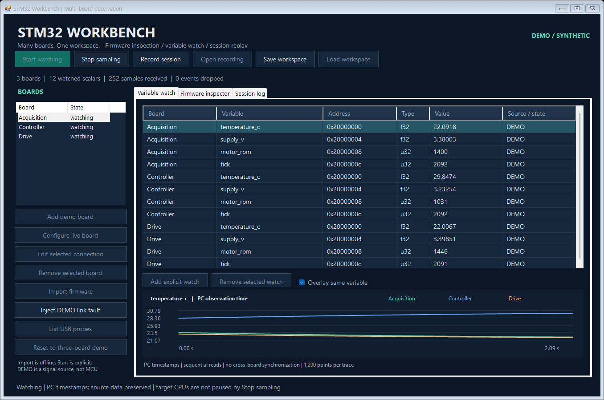
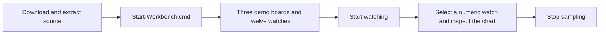
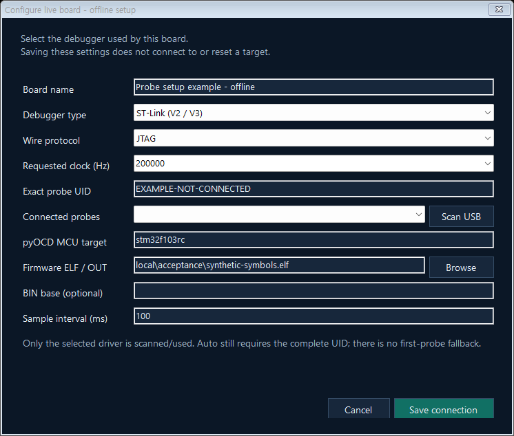
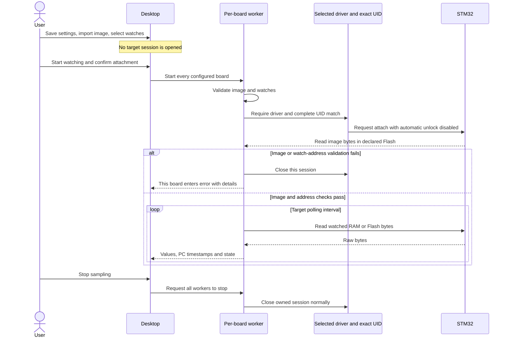
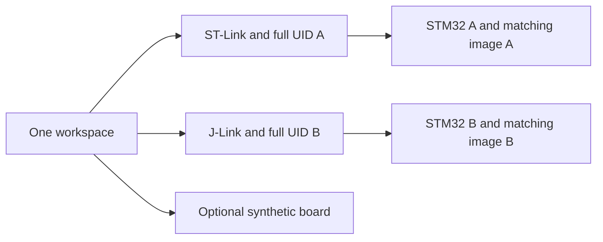
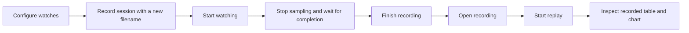
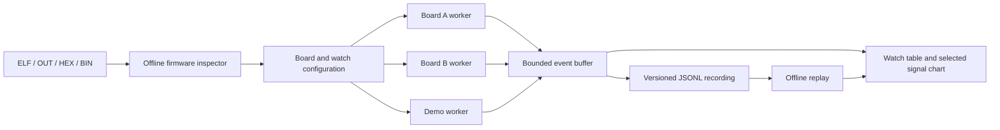

# STM32 Workbench

**Many boards. One workspace.**

A local desktop tool for inspecting ARM firmware, watching scalar variables across
multiple STM32 boards, and recording reproducible observation sessions.

Start with three synthetic boards, then bring your own firmware and debug probes.
The demo, firmware inspector, recorder, replay reader, and controller use Python's
standard library. Windows uses the included native C# desktop; hardware support
and DWARF type inference are optional extras.

**Status: v0.1.0 / alpha.** The Windows desktop has passed a fresh-source, empty-venv
workflow with actual window rendering, button actions, recording, replay, and restart.
Physical board compatibility is not yet validated. This is a newly written generic project; it ships no product firmware,
private device configuration, measurements, or proprietary SDK binaries.

[한국어 안내](README.ko.md) · [Architecture](docs/architecture.md) ·
[Firmware support](docs/firmware-support.md) · [Hardware setup](docs/hardware.md) ·
[Roadmap](docs/roadmap.md) · [Reproducible validation](docs/validation.md)



Actual application capture using synthetic signals. This is not a mockup or a
physical-board result.

## Choose a workflow

**한국어로 처음부터 따라 하려면 [설치·화면 항목·연결 시퀀스·문제 해결 안내](README.ko.md)를 보세요.**

| Your goal | Follow these steps |
| --- | --- |
| Try it without hardware | [Start from source](#start-from-the-source) → [Demo sequence](#demo-sequence) |
| Inspect your image | [Firmware inspection](#firmware-inspection-without-a-board) |
| Watch a physical STM32 | [Environment](#1-prepare-the-environment) → [Connection fields](#2-configure-a-live-board) → [Watches and start](#3-select-watches-and-start) |
| Use several probes | [Multi-board sequence](#multi-board-sequence) |
| Save and replay observations | [Recording and workspace sequence](#recording-and-workspace-sequence) |
| Diagnose a failure | [Troubleshooting](#troubleshooting) |

**Import firmware** parses a local file. **Scan USB** enumerates probes. Neither opens
a target session. **Start watching**, followed by the physical-connection confirmation,
opens configured live sessions. Loading firmware does not run that firmware without
a board, and selecting a probe type does not establish physical compatibility.

## Start from the source

Download/extract the repository ZIP, or clone it, and open the folder containing
`run.py`. Use the [source ZIP](https://github.com/mysunki/stm32-workbench/archive/refs/heads/main.zip)
or, with Git installed:

```console
git clone https://github.com/mysunki/stm32-workbench.git
cd stm32-workbench
```

Python 3.11+ is required. The validated Windows path also uses .NET Framework
4.x and its C# compiler; the UI executable is compiled locally on first launch.
No pip installation or USB driver is required for this demo. The first launch can
take a few seconds while compiling. Python 3.14.7 on Windows is the tested setup.

```console
python -I -B run.py gui
```

On Windows, double-click **Start-Workbench.cmd**. Press **Start watching** to see
three independent synthetic sources and an overlay chart. Select any numeric watch
to plot it. **Inject DEMO link fault** stops the selected synthetic board while the
other boards continue. Stop and restart sampling to clear injected demo faults.
No probes are enumerated or opened by startup.

On Linux/macOS, the original Tk frontend is selected; it needs a working Tk
installation (`python3-tk` on some Linux distributions). Those desktop paths are
not yet visually validated. `--ui tk` explicitly selects the original frontend.

Try a complete headless record-and-validate workflow:

```console
python -I -B run.py record-demo --duration 3 --output demo-session.jsonl
python -I -B run.py replay-info demo-session.jsonl
python -I -B run.py selftest
```

Existing recordings are never overwritten. Choose a new output name for each run.
`record-demo` generates test signals; it does not execute STM32 instructions or
reproduce an arbitrary firmware's behavior.

## Demo sequence



1. Launch the app and check the three boards in the sidebar and twelve rows in
   **Variable watch**. No USB enumeration happens at startup.
2. Click **Start watching**. Values and the received-sample count should increase.
   Select a numeric row to plot it; the Windows chart can overlay the same symbol
   name across boards.
3. Optionally select a demo board and click **Inject DEMO link fault**. That board
   should enter `error` while the other two continue sampling.
4. **Stop sampling**, then **Start watching** clears the injected demo fault.

Passing this workflow checks the synthetic collection and desktop path. It does not
check USB drivers, probes, or the execution of your firmware.

## What you can do

| Feature | v0.1.0 behavior |
| --- | --- |
| Multiple boards | Up to 16 configured boards; one connection owner and polling thread per board |
| Firmware inspection | Linked little-endian ARM ELF32 (`.elf`, `.out`, `.axf`), Intel HEX, raw BIN |
| Symbol discovery | Fixed scalar object symbols of 1–8 bytes; no hard-coded product variable names |
| Type handling | Raw bytes by default; explicit scalar interpretation; optional DWARF base-type inference |
| Live observation | Optional pyOCD adapter; per-board debugger type, exact UID, SWD/JTAG, requested clock, explicit MCU target and image comparison |
| Visualization | All-board watch table and a selected numeric chart; Windows overlays the same variable across boards |
| Recording | Versioned JSONL with source mode, raw bytes, timestamps, state changes, and detected event loss |
| Replay | Offline chronological playback; firmware files and probes are not required |
| Workspace | JSON board definitions, file associations, poll intervals, and watch lists |

The UI exposes memory observation. Breakpoints, stepping, flashing, target resets,
arbitrary memory writes, and source-level debugging are outside this release.

## Bring your firmware

### 1. Prepare the environment

You need a powered board, one independently identified probe per board, the correct
board/probe wiring and voltage reference, OS USB access, a supported MCU target, and
the image already programmed on that board. USB connects the PC to the probe;
an external probe also needs the board's SWD/JTAG connection. Follow the board and
probe manuals for pin assignments and power arrangements. Onboard probes are usable.

From the folder containing `run.py`, use Windows PowerShell:

```powershell
python -m venv .venv
.\.venv\Scripts\python.exe -m pip install -e ".[all]"
.\.venv\Scripts\pyocd.exe list --targets
.\.venv\Scripts\python.exe -I -B run.py gui
```

The install downloads optional packages. No shell activation or execution-policy
change is needed. Later, launch with this same venv interpreter. The double-click
launcher uses `python` from `PATH`; without an activated venv it may use a different
interpreter that cannot see your installed packages. The tested Windows/Python
3.14.7 demo does not establish optional-package installation or physical compatibility.

No runtime packages, USB drivers, target packs, or vendor applications are installed
automatically by the app. J-Link also requires the SEGGER driver/DLL. See the primary
[pyOCD installation](https://pyocd.io/docs/installing.html) and
[probe documentation](https://pyocd.io/docs/debug_probes.html).

Use the target identifier printed by `pyocd list --targets`, not your board's nickname.
If absent, identify the exact part, find/install the relevant CMSIS-Pack, then list
targets again. For example, replace this example part with your actual part:

```powershell
.\.venv\Scripts\pyocd.exe pack find STM32L073
.\.venv\Scripts\pyocd.exe pack install STM32L073
.\.venv\Scripts\pyocd.exe list --targets
```

Pack operations may need network access. The application needs a declared Flash
memory map for image comparison, so the generic `cortex_m` target is not a substitute
for a proper device definition. See [pyOCD target support](https://pyocd.io/docs/target_support.html).

### 2. Configure a live board

Stop sampling and finish recording before changing configuration. Choose
**Configure live board** to add a new board.



This capture uses a fake UID and JTAG as an offline settings example. Do not copy
those example values as settings for a physical device.

| Field | Meaning |
| --- | --- |
| **Board name** | Display name; independent of the MCU target and USB UID |
| **Debugger type** | Actual probe family from the table below |
| **Wire protocol** | `SWD` or `JTAG`, matching the wiring and device support |
| **Requested clock (Hz)** | Requested debug clock; default `1000000` means 1 MHz, subject to device support |
| **Exact probe UID** | Complete identifier reported by discovery, not an MCU name or board label |
| **Connected probes / Scan USB** | Explicitly enumerate only the chosen driver; select an item to fill its UID |
| **pyOCD MCU target** | Exact installed target identifier from `pyocd list --targets` |
| **Firmware ELF / OUT** | Image from the same build already on this board; select with **Browse** |
| **BIN base (optional)** | Actual load address for a BIN; ELF/HEX provide addresses themselves |
| **Sample interval (ms)** | Per-board polling target, default 100 ms; not a real-time guarantee |

The UI accepts clocks from 10,000 to 50,000,000 Hz and intervals from 20 to 10,000 ms.
An accepted input is not proof the device supports that clock. Debug clock and
sampling interval are separate settings; requested clocks may be quantized or rejected.

| Selection | Driver filter | Requirements and behavior |
| --- | --- | --- |
| Auto | Available drivers | Full UID must be unique; never picks the first device |
| ST-Link V2/V3 | `stlink` | Compatible probe firmware and OS USB access/driver |
| SEGGER J-Link | `jlink` | SEGGER driver/DLL; use the full pyOCD serial without unnecessary leading zeroes |
| CMSIS-DAP / DAPLink | `cmsisdap` | Compatible CMSIS-DAP firmware and USB/HID access |
| Raspberry Pi Debug Probe | `picoprobe` | Firmware compatible with pyOCD's picoprobe driver; not a claim about every firmware combination |

**Scan USB** enumerates USB probes, but does not open a target session. **Save
connection** only stores offline configuration. Saving does not attach, initialize,
or program a board. A wrong driver/UID pair is rejected without switching drivers.
Auto still requires an exact UID. The app never enables J-Link target power.

The following CLI commands explicitly enumerate physical USB probes, using the
same installed environment. Demo and acceptance do not run them:

```powershell
.\.venv\Scripts\python.exe -I -B run.py probes
.\.venv\Scripts\python.exe -I -B run.py probes --type stlink
.\.venv\Scripts\python.exe -I -B run.py probes --type jlink
```

### 3. Select watches and start

1. Select your new **live board** in the sidebar. Selection determines the editing
   target; it does not restrict which boards are started.
2. Choose **Import firmware** with the same-build image. Check the symbol list in
   **Firmware inspector**. **Re-importing clears that board's existing watches.**
3. Filter using **Find symbol**, select rows with Ctrl/Shift as needed, choose
   **Interpret as**, then click **Watch selected symbols**.
4. `auto` uses inferred types where available and otherwise keeps raw bytes. Select
   a type only when you know the declaration and size: for example, `f32` for a
   4-byte float, `u32` for a 4-byte unsigned integer. Raw bytes may not produce a
   numeric chart. Installing pyelftools enables supported DWARF base-type inference.
5. For BIN/HEX or a stripped ELF without scalar symbols, use **Variable watch →
   Add explicit watch** with the same build's known name, address, size and type.
   An ELF with scalar symbols only permits watches matching its symbol table.
   Objects must be 1–8-byte scalars in target-declared RAM/Flash; peripheral-register
   watches, structs, arrays and pointer dereferencing are unsupported.
6. Ensure **every configured board has at least one watch**. To view only hardware,
   remove unwanted demo boards with **Remove selected board** after adding the live
   board. At least one board must remain.
7. **Save workspace**, then **Start watching** and review the physical-connection
   prompt. **Start watching starts the whole workspace, not just the selected board.**
8. On success, states progress `connecting → watching`; values and sample counts
   update. Select a numeric row for its chart. A failing board enters `error` with
   details in **Session log** while independent boards continue.

**Edit selected connection** changes an existing live board after sampling and
recording stop. Changing the image path or BIN base clears watches; recheck the image
and reselect symbols. To change an existing watch's type, remove it with **Remove
selected watch** and add it again using the correct type. Firmware import is offline;
importing a real image into a demo board leaves its data synthetic.

### 4. Attachment sequence



ELF/OUT files should come from the same build as the firmware already on the board.
The live adapter compares load bytes that fall in the target's declared Flash before
showing variables. It refuses a mismatch. It does not program the firmware for you.

BIN and HEX contain no C variable names or types. For those formats, add explicit
address/size/type watches. BIN also needs a load address. A firmware file alone
cannot identify which USB probe belongs to which physical board.

The adapter requests attach and disables automatic unlock. Debug initialization
can still affect a device; absence of an app reset/flash button is not a guarantee
of zero target impact. These physical combinations have not been tested here.
See [hardware setup](docs/hardware.md).

## Multi-board sequence



1. Complete connection configuration, import and watch selection for board A.
2. Repeat for board B using its own probe UID, MCU target and matching image.
   Different probe families can be configured in the same workspace.
3. Assign one independent probe to each live board. The app does not switch one
   probe automatically among arbitrary targets or offer multidrop target selection.
4. Normally close any IDE/GDB/other tool session that owns the same probe first.
5. Check watches on every board, then **Start watching** once for the workspace.
   Selecting another board for display does not stop the others.
6. Use same-name numeric watch overlays when their units, types and meanings match.
7. **Stop sampling** stops all collection; it does not halt the target CPUs.

Limits are 16 configured boards and 64 watches per board. These are configuration
limits, not measured physical throughput. Reads are sequential and use the PC clock;
neither cross-board hardware synchronization nor an atomic multi-variable snapshot
is provided. Poll intervals are targets, not timing guarantees.

## Recording and workspace sequence

| File | Contains | Reuse |
| --- | --- | --- |
| `*.workspace.json` | Boards, UIDs, image paths, protocols/clocks, intervals, watches | **Load workspace**, then explicitly start; loading alone opens no probe |
| `*.jsonl` | Workspace metadata, raw bytes, timestamps, source modes, states, detected event loss | **Open recording → Start replay** without probes or original firmware |



Starting recording during collection records from that point forward. Open the
recording before **Start watching** to capture from the beginning. Existing recordings
are never overwritten. Replay opens no target sessions; editing boards/watches and
recording a new session are disabled in replay mode. After replay, **Load workspace**
restores your setup, or **Reset to three-board demo** returns to synthetic sources.
Workspace files do not contain measurement samples. Replay inputs are limited to
128 MiB per file.

Workspaces and recordings can include local paths, full probe UIDs and measurements.
Review them before sharing. The public source packager excludes user workspaces and
recordings; it includes only the explicit synthetic example.

## Firmware inspection without a board

```console
python -I -B run.py inspect path/to/application.elf
python -I -B run.py inspect path/to/application.out --json
python -I -B run.py inspect path/to/application.bin --base 0x08000000
```

`.out` is accepted when its contents are ARM ELF32. Proprietary/non-ELF OUT formats,
ELF64, relocatable objects, heuristic MAP parsing, structs, arrays, pointer
dereferencing, register/stack variables, and optimized-away objects are unsupported.
`0x08000000` in the BIN command is an example, not an automatically correct address;
use the actual linker/load address, which may differ when a bootloader is present.

## Troubleshooting

| Symptom | Check in order |
| --- | --- |
| Demo does not start | Python version → current folder containing `run.py` → Windows .NET Framework 4.x C# compiler; retain the first console error |
| Optional pyOCD package not found | Launch with the same venv interpreter used for installation |
| J-Link DLL error | SEGGER package/DLL installation and interpreter architecture compatibility |
| No probes in Scan USB | Selected family → USB/device recognition → OS driver/access → probe firmware compatibility |
| `Exact probe UID not found or not unique` | Complete discovered UID, correct family and uniqueness when using Auto |
| Target error or no memory map | Installed `pyocd list --targets` output and correct device pack, not the display-name field |
| Probe busy/open failure | Normally end another IDE/GDB/tool session owning that probe |
| Empty symbol list | Linked ARM ELF32 with retained scalar symbols; BIN/HEX and optimized-away objects have no discoverable variable names |
| `Choose at least one watch for every configured board` | Check other boards with empty watch lists; remove unwanted boards |
| `Firmware mismatch` | Same-build image, correct physical board and BIN load address; no automatic flashing or bypass is offered |
| `No load bytes fall in target-declared Flash` | Actual image load addresses and target map; RAM-only images cannot pass this verification method |
| Unexpected values or no numeric chart | Raw vs numeric type, correct declaration/size, matching build, numeric row selection |
| Editing disabled | Stop sampling, wait for workers, finish recording; load a workspace to leave replay |
| Watches disappeared | Re-import or image-path/BIN-base edits clear watches; select them again for the current build |
| Recording file already exists | Use a new filename |

For reports, include OS/Python/pyOCD versions, probe family/firmware, MCU target,
input format and the first **Session log** error. Private firmware, full UIDs and
personal paths are not needed in a public report. Distinguish physical results from
the [validation matrix](docs/hardware.md#validation-matrix).

## How the pieces fit



Reads are sequential, not atomic snapshots. Independent boards share the PC clock,
not a hardware trigger. The interval is a polling target, not a timing guarantee.
Timing brackets and raw bytes are retained for investigation.

## Reproduce and contribute

```console
python -I -B run.py selftest
python -I -B tools/verify_from_scratch.py --output local/my-new-verification
python -I -B tools/package_source.py --output ../stm32-workbench-source.zip
```

The suite uses generated ELF/HEX fixtures and fake hardware. It never enumerates
USB probes, installs packages, or connects to a target. See [CONTRIBUTING.md](CONTRIBUTING.md).
The source packager uses an explicit allowlist and refuses symlinks, unexpected
artifacts, obvious credentials, and oversized files.

The Windows acceptance command copies audited source to a new directory, creates
an isolated venv without downloads, compiles the native host from source, and runs
the actual desktop workflow. It checks three boards/twelve signals, chart data,
fault isolation, recording, firmware import, typed watch selection, board add/remove,
workspace load, replay, and a fresh process restoring the saved workspace. Evidence
includes JSON results and six actual-control PNG captures. File dialog paths are
supplied by the verifier; the application buttons, controller, engine, and files
are real. This is a local source snapshot test, not a claimed GitHub download.
The debugger dropdown and SWD/JTAG/clock save-and-restore are exercised offline;
automated acceptance never scans or connects to physical probes.

To inspect a synthetic ELF example without private firmware:

```console
python -I -B tools/make_example.py synthetic-symbols.elf
python -I -B run.py inspect synthetic-symbols.elf
```

The generated file is for symbol inspection, not runnable MCU firmware; never
program it to a physical target.

To create your own GitHub repository from this directory using an already installed
and authenticated GitHub CLI:

```powershell
.\Publish-GitHub.ps1 -Owner mysunki -Name stm32-workbench -Visibility public
```

These publication tools create a **new** repository; they do not update an existing
`mysunki/stm32-workbench`. For changes to an existing repository, review and validate
your clone, then use normal commits/pushes or a pull request. New-repository tools
stop if the destination already exists.

The script checks the authenticated account, runs the tests and source audit,
and now requires the fresh-environment desktop acceptance before publication. It
commits only the tested, allowlisted source snapshot and creates a new repository. It does not
overwrite an existing GitHub repository or force-push. **A checkout is not published
until this script or another GitHub publication workflow completes successfully.**

On Windows, **Publish-Start.cmd** is a user-launched alternative: it runs acceptance
first, opens the evidence folder for your review, and continues with normal installer
prompts and browser login only after you confirm. It does not change execution policies.

## License and acknowledgments

New project source is available under the [MIT License](LICENSE).
STM32 is a trademark of STMicroelectronics; this is an independent project.
Optional pyOCD and pyelftools packages retain their respective licenses and are not
vendored here. Third-party documentation and API references are listed in
[docs/references.md](docs/references.md).
