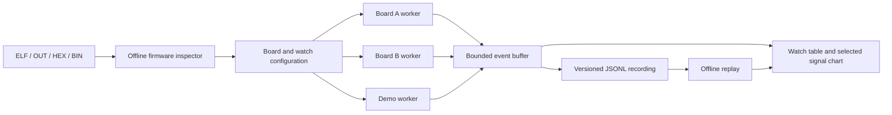

# STM32 Workbench

**Many boards. One workspace.**

A local desktop tool for inspecting ARM firmware, watching scalar variables across
multiple STM32 boards, and recording reproducible observation sessions.

Start with three synthetic boards, then bring your own firmware and debug probes.
The demo, firmware inspector, recorder, replay reader, and controller use Python's
standard library. Windows uses the included native C# desktop; hardware support
and DWARF type inference are optional extras.

**Status: v0.1.0 / alpha.** The Windows desktop has passed a fresh-source, empty-venv
workflow with actual window rendering, button actions, recording, replay, and restart.
Physical board compatibility is not yet validated. This is a newly written generic project; it ships no product firmware,
private device configuration, measurements, or proprietary SDK binaries.

[한국어 안내](README.ko.md) · [Architecture](docs/architecture.md) ·
[Firmware support](docs/firmware-support.md) · [Hardware setup](docs/hardware.md) ·
[Roadmap](docs/roadmap.md) · [Reproducible validation](docs/validation.md)


Actual application capture using synthetic signals. This is not a mockup or a
physical-board result.

## Start from the source

Download/extract the repository ZIP, or clone it, and open the folder containing
`run.py`. Python 3.11+ is required. The validated Windows path also uses .NET Framework
4.x and its C# compiler; the UI executable is compiled locally on first launch.
No pip installation or USB driver is required for this demo. The first launch can
take a few seconds while compiling. Python 3.14.7 on Windows is the tested setup.

```console
python -I -B run.py gui
```

On Windows, double-click **Start-Workbench.cmd**. Press **Start watching** to see
three independent synthetic sources and an overlay chart. Select any numeric watch
to plot it. **Inject DEMO link fault** stops the selected synthetic board while the
other boards continue. Stop and restart sampling to clear injected demo faults.
No probes are enumerated or opened by startup.

On Linux/macOS, the original Tk frontend is selected; it needs a working Tk
installation (`python3-tk` on some Linux distributions). Those desktop paths are
not yet visually validated. `--ui tk` explicitly selects the original frontend.

Try a complete headless record-and-validate workflow:

```console
python -I -B run.py record-demo --duration 3 --output demo-session.jsonl
python -I -B run.py replay-info demo-session.jsonl
python -I -B run.py selftest
```

Existing recordings are never overwritten. Choose a new output name for each run.
`record-demo` generates test signals; it does not execute STM32 instructions or
reproduce an arbitrary firmware's behavior.

## What you can do

| Feature | v0.1.0 behavior |
| --- | --- |
| Multiple boards | Up to 16 configured boards; one connection owner and polling thread per board |
| Firmware inspection | Linked little-endian ARM ELF32 (`.elf`, `.out`, `.axf`), Intel HEX, raw BIN |
| Symbol discovery | Fixed scalar object symbols of 1–8 bytes; no hard-coded product variable names |
| Type handling | Raw bytes by default; explicit scalar interpretation; optional DWARF base-type inference |
| Live observation | Optional pyOCD adapter, exact probe UID, explicit target, image comparison before watching |
| Visualization | All-board watch table and a selected numeric chart; Windows overlays the same variable across boards |
| Recording | Versioned JSONL with source mode, raw bytes, timestamps, state changes, and detected event loss |
| Replay | Offline chronological playback; firmware files and probes are not required |
| Workspace | JSON board definitions, file associations, poll intervals, and watch lists |

The UI exposes memory observation. Breakpoints, stepping, flashing, target resets,
arbitrary memory writes, and source-level debugging are outside this release.

## Bring your firmware

1. Configure a live board with its full probe UID, pyOCD target name, and image path.
2. Select that board and choose **Import firmware**. Import is always offline.
3. In **Firmware inspector**, select scalar symbols and click **Watch selected symbols**.
4. Use the inferred type if available, or explicitly select the C scalar type you know.
   Unknown types remain bytes; a 4-byte object is not automatically a float.
5. Press **Start watching** and review the hardware attachment prompt.

ELF/OUT files should come from the same build as the firmware already on the board.
The live adapter compares load bytes that fall in the target's declared Flash before
showing variables. It refuses a mismatch. It does not program the firmware for you.

BIN and HEX contain no C variable names or types. For those formats, add explicit
address/size/type watches. BIN also needs a load address. A firmware file alone
cannot identify which USB probe belongs to which physical board.

Install optional features only on a machine where you want to use them:

```console
python -m venv .venv
# Activate .venv with your shell, then:
python -m pip install -e ".[all]"
stm32-workbench gui
stm32-workbench probes
```

No runtime packages, USB drivers, target packs, or vendor applications are installed
automatically when running the app. The separate publication launcher can offer
standard Git/GitHub CLI installation. Device support depends on the pyOCD version and locally available
target definitions. See [hardware setup](docs/hardware.md).

## Firmware inspection without a board

```console
python -I -B run.py inspect path/to/application.elf
python -I -B run.py inspect path/to/application.out --json
python -I -B run.py inspect path/to/application.bin --base 0x08000000
```

`.out` is accepted when its contents are ARM ELF32. Proprietary/non-ELF OUT formats,
ELF64, relocatable objects, heuristic MAP parsing, structs, arrays, pointer
dereferencing, register/stack variables, and optimized-away objects are unsupported.

## How the pieces fit



Reads are sequential, not atomic snapshots. Independent boards share the PC clock,
not a hardware trigger. The interval is a polling target, not a timing guarantee.
Timing brackets and raw bytes are retained for investigation.

## Reproduce and contribute

```console
python -I -B run.py selftest
python -I -B tools/verify_from_scratch.py --output local/my-new-verification
python -I -B tools/package_source.py --output ../stm32-workbench-source.zip
```

The suite uses generated ELF/HEX fixtures and fake hardware. It never enumerates
USB probes, installs packages, or connects to a target. See [CONTRIBUTING.md](CONTRIBUTING.md).
The source packager uses an explicit allowlist and refuses symlinks, unexpected
artifacts, obvious credentials, and oversized files.

The Windows acceptance command copies audited source to a new directory, creates
an isolated venv without downloads, compiles the native host from source, and runs
the actual desktop workflow. It checks three boards/twelve signals, chart data,
fault isolation, recording, firmware import, typed watch selection, board add/remove,
workspace load, replay, and a fresh process restoring the saved workspace. Evidence
includes JSON results and five actual-control PNG captures. File dialog paths are
supplied by the verifier; the application buttons, controller, engine, and files
are real. This is a local source snapshot test, not a claimed GitHub download.

To inspect a synthetic ELF example without private firmware:

```console
python -I -B tools/make_example.py synthetic-symbols.elf
python -I -B run.py inspect synthetic-symbols.elf
```

The generated file is for symbol inspection, not runnable MCU firmware; never
program it to a physical target.

To create your own GitHub repository from this directory using an already installed
and authenticated GitHub CLI:

```powershell
.\Publish-GitHub.ps1 -Owner mysunki -Name stm32-workbench -Visibility public
```

The script checks the authenticated account, runs the tests and source audit,
and now requires the fresh-environment desktop acceptance before publication. It
commits only the tested, allowlisted source snapshot and creates a new repository. It does not
overwrite an existing GitHub repository or force-push. **A checkout is not published
until this script or another GitHub publication workflow completes successfully.**

On Windows, **Publish-Start.cmd** is a user-launched alternative: it runs acceptance
first, opens the evidence folder for your review, and continues with normal installer
prompts and browser login only after you confirm. It does not change execution policies.

## License and acknowledgments

New project source is available under the [MIT License](LICENSE).
STM32 is a trademark of STMicroelectronics; this is an independent project.
Optional pyOCD and pyelftools packages retain their respective licenses and are not
vendored here. Third-party documentation and API references are listed in
[docs/references.md](docs/references.md).
